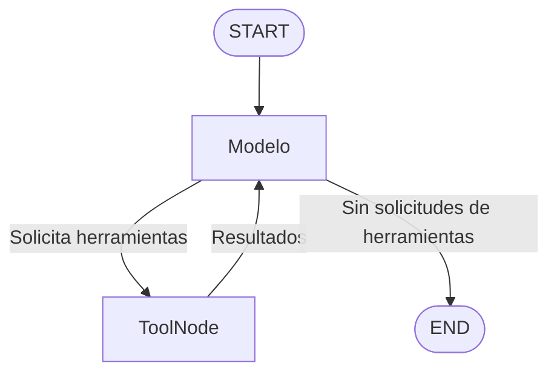

# Preentrega 5: Agente comercial con memoria persistente

Asistente desarrollado para Coderhouse – AI Engineering. Resuelve consultas sobre clientes y pedidos simulados mediante un ciclo ReAct con LangGraph, herramientas propias y memoria persistente en SQLite.

El modelo selecciona las herramientas y sus argumentos. La aplicación valida las entradas, ejecuta las funciones y devuelve sus resultados al modelo para que pueda continuar o responder.

## Tecnologías

- Python 3.12 (probado con 3.12.10).
- LangGraph: `StateGraph`, `MessagesState`, `ToolNode` y `tools_condition`.
- LangChain OpenAI: `ChatOpenAI` y `bind_tools`.
- Pydantic: esquemas y validación de entradas.
- SQLite con `AsyncSqliteSaver` y `aiosqlite`.
- `asyncio`, `python-dotenv` y exportación de trazas a JSON.

Las versiones utilizadas se encuentran fijadas en `requirements.txt`.

## Archivos

| Archivo | Responsabilidad |
|---|---|
| `datos.py` | Clientes y pedidos simulados, con tipos `TypedDict`. |
| `herramientas.py` | Esquemas de entrada y herramientas `buscar_cliente` y `consultar_pedidos`. |
| `agente.py` | Configuración del modelo, instrucciones, estado y construcción del grafo. |
| `main.py` | Tres demostraciones del agente. |
| `exportar_traza.py` | Recuperación de un hilo desde SQLite y exportación a JSON. |
| `requirements.txt` | Dependencias con versiones exactas. |
| `.env.example` | Ejemplo de configuración sin credenciales. |
| `.gitignore` | Exclusión de credenciales, entorno virtual y memoria local. |
| `trazas/traza_comercial.json` | Evidencia de dos llamadas dependientes y seguimiento con memoria. |
| `trazas/traza_cliente_inexistente.json` | Evidencia de búsqueda sin coincidencias y pedido de aclaración. |

`memoria.sqlite` se genera localmente y no se incluye en el repositorio.

## Instalación y configuración

Desde la carpeta del proyecto, en PowerShell:

```powershell
py -3.12 -m venv .venv
.\.venv\Scripts\Activate.ps1
python -m pip install -r requirements.txt
python -m pip check
```

Si PowerShell bloquea la activación, se puede permitir su ejecución únicamente durante la sesión actual y volver a activar el entorno:

```powershell
Set-ExecutionPolicy -Scope Process -ExecutionPolicy Bypass
.\.venv\Scripts\Activate.ps1
```

Crear la configuración local:

```powershell
Copy-Item .env.example .env
```

Editar `.env` con una clave de API válida:

```dotenv
OPENAI_API_KEY=tu_clave_real
OPENAI_MODEL=gpt-4o-mini
```

El programa carga `.env` desde la carpeta de `agente.py` y comprueba que la clave esté definida. Ejecutar las demostraciones requiere acceso a la API y puede generar consumo facturable. Las trazas incluidas pueden inspeccionarse sin ejecutar el modelo.

## Ejecutar las demostraciones

```powershell
python main.py
```

El programa ejecuta tres turnos de prueba:

| Demostración | Pregunta | Resultado esperado |
|---|---|---|
| 1. Consulta de varios pasos | ¿Cuántos pedidos tiene Repuestos del Centro y cuál es el importe total? | Busca el cliente, obtiene el ID 102 y consulta sus pedidos: 3 pedidos por $14.500. |
| 2. Seguimiento | ¿Y cuál fue el último pedido? | Recupera el cliente del contexto: último pedido del 20/10/2026, por $4.000. |
| 3. Aclaración | ¿Cuántos pedidos tiene Ferretería Luna y cuál es el importe total? | Informa que no encuentra coincidencias y pide revisar el nombre. |

La redacción de las respuestas puede variar. El último pedido de los datos simulados es el 1003.

Las dos primeras demostraciones comparten `thread_id`; la tercera usa otro hilo. En cada ejecución se genera un sufijo nuevo para evitar que consultas anteriores resuelvan de antemano la primera búsqueda. Los identificadores se imprimen en consola.

El programa muestra únicamente los mensajes nuevos de cada turno, pero conserva el historial completo en el estado.

## Arquitectura y ciclo ReAct



`EstadoAgente` hereda de `MessagesState`, que incorpora el reducer `add_messages`. El nodo del modelo recibe las instrucciones y el historial, y devuelve solamente su nuevo mensaje.

`tools_condition` decide el destino a partir de las solicitudes de herramientas del mensaje del modelo. No se seleccionan herramientas mediante rutas manuales basadas en palabras de la pregunta. `ToolNode` ejecuta las solicitudes y devuelve los resultados al modelo.

La consulta inicial requiere dos llamadas dependientes:

1. `buscar_cliente(nombre="Repuestos del Centro")` obtiene `cliente_id=102`.
2. `consultar_pedidos(cliente_id=102)` devuelve los pedidos y sus totales.

Se configura `recursion_limit=10` para limitar los pasos de cada invocación. El cliente del modelo utiliza `timeout=30` y `max_retries=2`.

## Herramientas y validación

### `buscar_cliente`

Admite un nombre completo o parcial, elimina espacios de los extremos y rechaza entradas vacías. La búsqueda no distingue mayúsculas y minúsculas. Devuelve uno de estos estados:

- `encontrado`: un cliente identificado.
- `sin_coincidencias`: solicita revisar el nombre.
- `ambiguo`: varias coincidencias; el agente debe pedir que se elija un cliente.

### `consultar_pedidos`

Recibe un identificador mayor que cero y comprueba si el cliente existe. Devuelve la lista de pedidos, su cantidad y el importe total.

- Cliente 102: 3 pedidos por $14.500.
- Cliente 103, Taller Norte: existe, pero no tiene pedidos; estado `ok` y totales en cero.
- Identificador inexistente: estado `cliente_inexistente`; no se interpreta como un cliente sin pedidos.

Los modelos Pydantic validan las entradas durante la ejecución. Los `TypedDict` describen los datos y las salidas para verificación estática; no validan las salidas en tiempo de ejecución.

La demostración de recuperación ante información insuficiente utiliza una búsqueda sin coincidencias: el resultado vuelve al modelo y este pide una aclaración, sin inventar un identificador ni pedidos. No se simula una caída de infraestructura en las demostraciones.

## Persistencia

Los datos comerciales simulados permanecen en `datos.py`. SQLite almacena los checkpoints del grafo, incluidos los mensajes del usuario, solicitudes de herramientas, resultados y respuestas.

Se utiliza `AsyncSqliteSaver`, la variante asíncrona del checkpointer SQLite, para mantener la ejecución con `ainvoke`. La conexión se administra con `async with` y se cierra al finalizar.

Los checkpoints permanecen tras cerrar el programa. Para continuar una conversación deben conservarse tanto `memoria.sqlite` como su `thread_id`. Ejecutar nuevamente `main.py` crea hilos nuevos deliberadamente; no continúa los anteriores.

Durante el desarrollo se comprobó la continuidad entre procesos: se ejecutó una consulta inicial, terminó el script y se volvió a ejecutar con el mismo hilo preguntando por el último pedido. La respuesta recuperó el cliente y sus datos anteriores.

También se puede verificar la lectura persistente cerrando `main.py` y exportando uno de los hilos impresos mediante el siguiente comando. La exportación abre SQLite en otro proceso y recupera su historial sin enviar una nueva consulta al modelo.

## Exportar trazas

Usar los identificadores que imprimió la ejecución local. Sustituir los valores `REEMPLAZAR_ID_COMERCIAL` y `REEMPLAZAR_ID_ACLARACION` por los identificadores completos correspondientes:

```powershell
python exportar_traza.py --thread-id REEMPLAZAR_ID_COMERCIAL --salida trazas/traza_comercial.json --descripcion "Consulta con dos herramientas y seguimiento con memoria."
```

```powershell
python exportar_traza.py --thread-id REEMPLAZAR_ID_ACLARACION --salida trazas/traza_cliente_inexistente.json --descripcion "Busqueda sin coincidencias y pedido de aclaracion."
```

El exportador utiliza `aget_state` y `messages_to_dict`. No invoca al modelo ni agrega mensajes, aunque la configuración actual requiere `.env` porque importa `agente.py`.

La ejecución incluida en el repositorio contiene:

| Traza | Mensajes | Evidencia |
|---|---|---|
| `traza_comercial.json` | 8 | Dos llamadas dependientes, sus resultados, respuesta inicial y seguimiento. |
| `traza_cliente_inexistente.json` | 4 | Búsqueda sin coincidencias y solicitud de aclaración. |

Las trazas contienen mensajes y acciones observables; no representan pensamientos internos privados del modelo. Si el modelo realiza llamadas adicionales en una ejecución nueva, el número de mensajes puede variar.

## Verificaciones realizadas

- Herramientas: cliente con pedidos, cliente existente sin pedidos e identificador inexistente.
- Agente: dos llamadas dependientes y respuesta consistente con los datos simulados.
- Memoria: seguimiento en el mismo hilo y recuperación tras finalizar el proceso.
- Información insuficiente: búsqueda sin coincidencias y pedido de aclaración.
- Exportación: JSON válido con solicitudes y resultados vinculados por sus identificadores.
- Dependencias: `python -m pip check` sin conflictos en el entorno utilizado.

Estas verificaciones fueron manuales; el repositorio no incluye una suite de pruebas automatizadas.

## Alcance

Proyecto educativo con datos simulados, sin conexión a una base comercial real ni operaciones de escritura. Las búsquedas no normalizan tildes. El historial se acumula y no incorpora todavía resumen ni recorte automático; la demostración utiliza conversaciones breves. Los resultados guardados representan el momento de la consulta y no se actualizan solos.

Para publicar el repositorio se incluyen el código, `.env.example`, `requirements.txt`, este README y las trazas. `.env`, `.venv`, cachés y archivos SQLite quedan excluidos mediante `.gitignore`.
